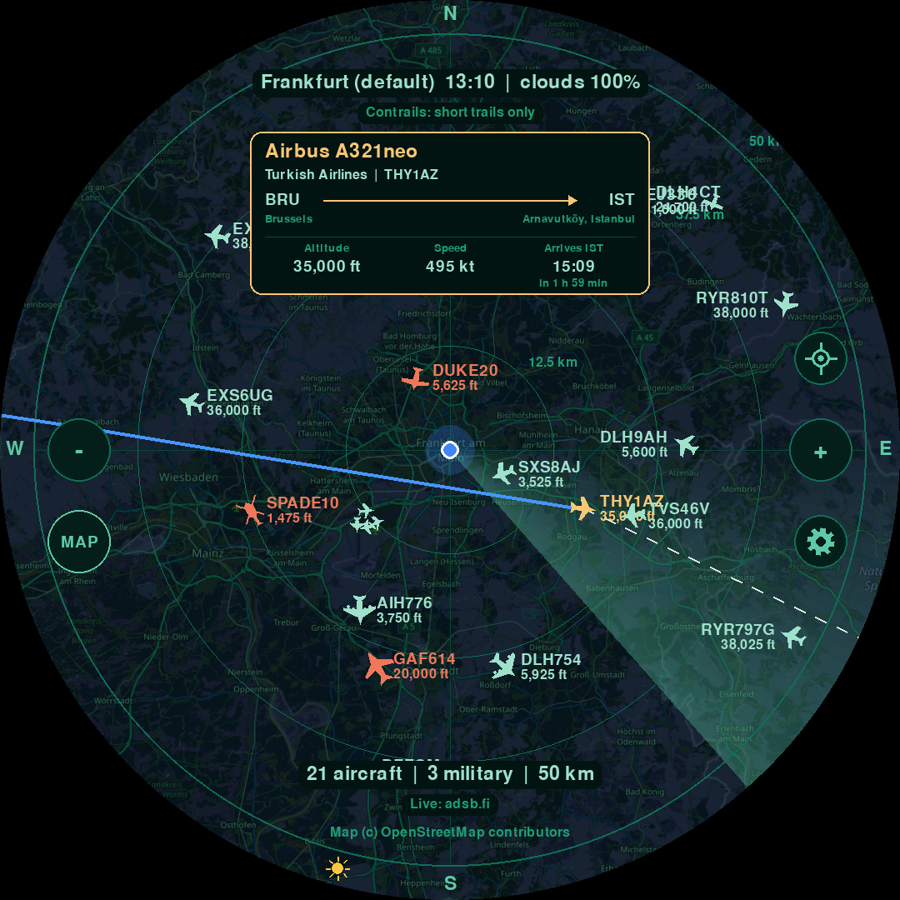
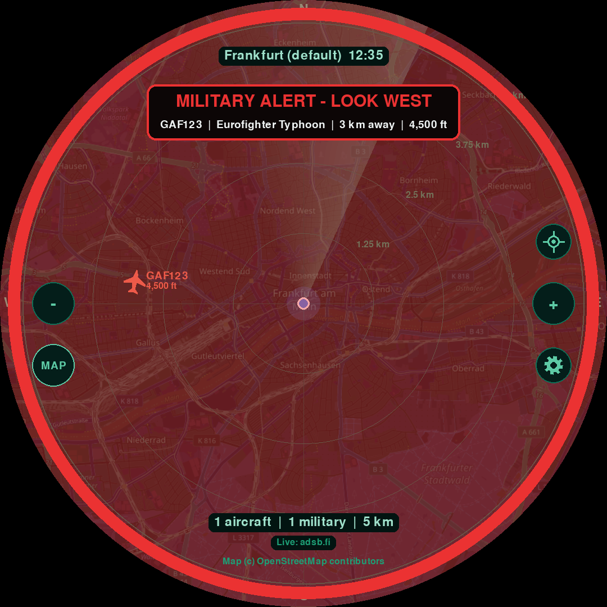
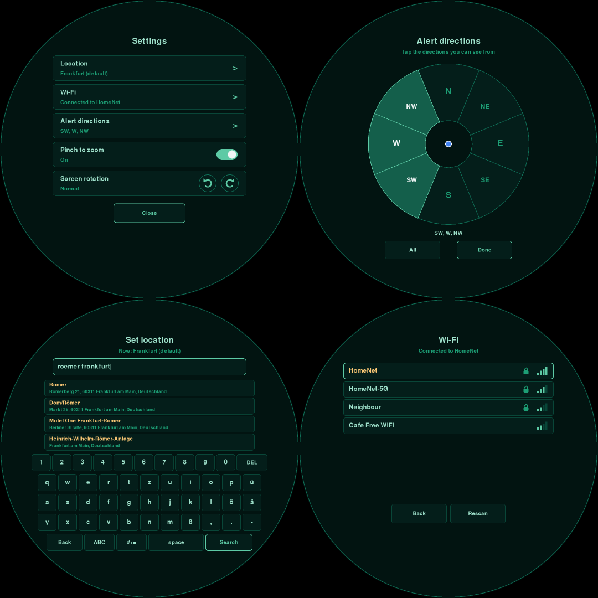

# Sky Radar

A live aircraft radar for a round touch screen and a Raspberry Pi. It shows every plane around you, with
military aircraft highlighted, on a dark street map. Tap a plane to see its details.

Built for the Waveshare 5" round 1080x1080 HDMI touch display, but it runs on any screen, including Windows and macOS for development.



## Features

- Live aircraft from the free [adsb.fi](https://adsb.fi) open data API, with [adsb.lol](https://adsb.lol) as an
  automatic backup, or from your own RTL-SDR receiver. If one service is busy or rate-limited, Sky Radar
  switches to the other by itself. The list is `api_urls` in `config.json`
- Military aircraft in coral, civil aircraft in teal, with trails and heading
- Tap a plane for a small details card. It appears on the half of the screen away from the plane, so the plane stays visible:
  - **Civil:** model (e.g. Airbus A320neo), airline, from → to, altitude, speed in knots, and arrival time at the destination
  - **Military:** model (e.g. Eurofighter Typhoon, F-35, Rafale), operator, altitude, speed,
    and when it will be closest to you. Military flights don't publish a destination.
  - The selected plane's path: **blue** = where it has flown (from takeoff), **white dashed** = the way to its destination
    (civil only). Tap the card to shrink it to a bar so the whole path is visible, and tap again to open it.
- Drag to move around the map and pinch to zoom, like Google Maps. Your location is a blue dot, and the crosshair button brings you back
- 12 zoom steps from a 50 m radius to 150 km
- Dark OpenStreetMap map underneath, cached for offline use
- **Red screen alert** when a military aircraft is within 5 km of you, **yellow alert** when any other aircraft is within 5 km
  (distances set in `config.json` as `military_alert_km` and `civil_alert_km`). Tap the alert banner to see that plane
  - The banner says which way to look, e.g. **MILITARY ALERT - LOOK WEST**
  - **Settings → Alert directions:** tap the compass directions you can actually see from (for example only W for a
    west-facing balcony). Planes in the other directions don't trigger alerts. **All** = alerts from every direction
- Settings on the screen itself (gear button):
  - **Location:** type an address and pick from suggestions as you type
  - **Wi-Fi:** choose a network and enter the password on the on-screen keyboard
  - **Alert directions:** compass to choose which sides (N, NE, E … NW) can trigger alerts
  - **Pinch to zoom:** on/off switch for real multi-touch on the Pi (off = touch works like a mouse)
  - **Screen rotation:** ↺ / ↻ buttons turn the screen 90° at a time. On the Pi the whole screen and touch turn
    and it's remembered after a reboot; on a PC the app turns its own window.
- First start: if there's no internet it opens Wi-Fi setup, then asks for your location

| Alert | Settings |
|---|---|
|  |  |
| Red alert for a military jet 3 km away, with the direction to look (example plane) | Settings menu, alert directions (west side selected), location search, Wi-Fi |

Want to hang it on an IKEA Skådis pegboard? There's a 3D-printable enclosure for the display and the Pi 5 in [`hardware/`](hardware/README.md).

## Quick start (one file, any system)

`run.py` detects the system and does everything: it creates a virtual environment (`.venv`),
installs the packages, and starts Sky Radar. Later runs skip whatever is already done.

| System | How to start |
|---|---|
| Windows | Install [Python 3](https://www.python.org/downloads/), then **double-click `run.py`** (or run `py run.py`) |
| Raspberry Pi / Linux | `python3 run.py` |
| macOS | `python3 run.py` |

On a Raspberry Pi it also starts fullscreen, installs any missing system packages with apt,
adds itself to the desktop autostart so the radar comes up at every boot, and turns off the
desktop's touch "mouse emulation". Raspberry Pi OS turns every touch into a single mouse pointer by
default, which makes pinch-to-zoom impossible. A backup of the original setting is saved as
`~/.config/labwc/rc.xml.before-sky-radar`. You can switch this on and off any time with
**Settings → Pinch to zoom**, and `run.py` keeps whatever you chose there.

Options: `--update` (download the newest version from GitHub and restart) · `--setup-only` (set up without starting) · `--windowed` (no fullscreen on a Pi) · `--no-autostart` · `--keep-touch-emulation` (leave the Pi's touch settings alone; pinch won't work).

Controls: drag to move the map · pinch to zoom (touch screen) · crosshair button or `H` = back to your location · tap/click a plane for details · tap empty space to close · `+`/`-` buttons or mouse wheel to zoom ·
`MAP` button or `M` to show/hide the map · gear button or `S` for settings · `F` fullscreen · `Esc`/`Q` quit.

To try the Wi-Fi screens on a PC, start with `SKY_RADAR_FAKE_WIFI=1`. That shows pretend networks, and the password is `password123`.

## Raspberry Pi setup

1. Flash **Raspberry Pi OS (64-bit, with desktop)** with Raspberry Pi Imager. You can skip Wi-Fi in the imager
   and set it up on the radar screen instead.
2. Connect the round screen: HDMI to the Pi's micro-HDMI port 0, and USB from the screen's "Touch" port to the Pi.
   If the screen stays blank, check the Waveshare wiki page for the 5inch 1080x1080 LCD for the `config.txt` lines.
3. Copy this folder to the Pi (USB stick or `git clone`), then run it once:
   ```
   cd sky-radar && python3 run.py
   ```
   That sets everything up, starts the radar fullscreen, and makes it start automatically at every boot.
   To stop autostart, delete the Sky Radar line in `~/.config/labwc/autostart`.

### Updating the Pi after you change the code

1. On your PC, commit and push your changes to GitHub:
   ```
   git add .
   git commit -m "Describe what you changed"
   git push
   ```
2. Update the Pi from your PC. It downloads the new version, installs anything new and restarts
   the radar on its screen, with no reboot needed:
   ```
   ssh sky-radar@sky-radar.local "python3 ~/sky-radar/run.py --update"
   ```
   Use your own username and hostname if you chose different ones in Raspberry Pi Imager.
   On the Pi itself (keyboard or terminal) it's just `python3 ~/sky-radar/run.py --update`.

If the update says `git pull failed`, a file in `~/sky-radar` on the Pi was edited by hand.
Undo those edits with `cd ~/sky-radar && git checkout -- .` and run the update again.
Your `location.json` and `prefs.json` are never touched by updates.

### Wi-Fi

The Wi-Fi screen uses NetworkManager (`nmcli`), the default on Raspberry Pi OS Bookworm.
NetworkManager stores the password in its own protected system config and reconnects automatically after every reboot.
Sky Radar itself never writes the password to disk.

If connecting fails with "Not allowed to change Wi-Fi", run the app from the Pi's desktop session (autostart above),
or add your user to the `netdev` group: `sudo usermod -aG netdev $USER`, then reboot.

### Location

Tap the gear button, then **Location**, and type an address, town or place. Suggestions come from
[Photon](https://photon.komoot.io), which is based on OpenStreetMap data. Tap one and the radar is centred there.
The choice is saved in `location.json`, which is git-ignored, so your address never ends up in the repository.
`lat`/`lon` in `config.json` are only a fallback until a location is chosen.

Only a rounded position (about 1 km) is sent to the flight API.

## Map

The map uses OpenStreetMap tiles, recoloured dark. Tiles are downloaded once into `map_tiles/` (git-ignored)
and work offline after that. `map_brightness` (0–1) in `config.json` sets how strong the map looks, and `"map": false` turns it off.
Please keep usage light, following the [OSM tile policy](https://operations.osmfoundation.org/policies/tiles/).

## Own receiver (optional RTL-SDR dongle)

1. Plug in an RTL-SDR dongle and a 1090 MHz antenna. A window facing the sky is OK, a roof or attic is best.
2. Install readsb and tar1090 (wiedehopf's install scripts on GitHub):
   ```
   sudo bash -c "$(wget -O - https://github.com/wiedehopf/adsb-scripts/raw/master/readsb-install.sh)"
   sudo bash -c "$(wget -O - https://github.com/wiedehopf/tar1090/raw/master/install.sh)"
   sudo readsb-set-location <your-lat> <your-lon>
   ```
3. In `config.json`, change `"source": "api"` to `"source": "local"`.

Military flags come from the aircraft database that tar1090 installs. Military aircraft heard without a position
show up as "+N military heard, no position".

## Plane details

Details are fetched only for the plane you tap, and are cached:
- Model, owner and route come from [adsbdb.com](https://www.adsbdb.com). Routes come from a database of scheduled
  flights, so occasionally they are out of date.
- The flown path comes from the [OpenSky Network](https://opensky-network.org) tracks API (free, rate-limited).
  If OpenSky doesn't have the plane, the trail the radar has collected itself is shown instead.
- Many fighters don't broadcast their type at all. Then the card says "Type not broadcast".

## Notes

- Not every military aircraft is visible. Many fighters switch ADS-B off or send no position.
  The unfiltered adsb.fi / adsb.lol feeds and MLAT catch a good share of them.
- Receiving ADS-B is legal in most countries. Be thoughtful about publishing live military movements.

Map data © OpenStreetMap contributors. Flight data from adsb.fi and adsb.lol. Aircraft and route data from adsbdb.com. Flight tracks from the OpenSky Network.
Address search by Photon (komoot).

## Contributing

Improvements are welcome! Please **fork** the repo and open a **pull request**. Every change is reviewed
and approved by the maintainer before it's merged. See [CONTRIBUTING.md](CONTRIBUTING.md) for the steps.

## License

MIT © 2026 siddhesh1008. See [LICENSE](LICENSE).
