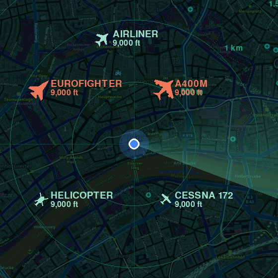
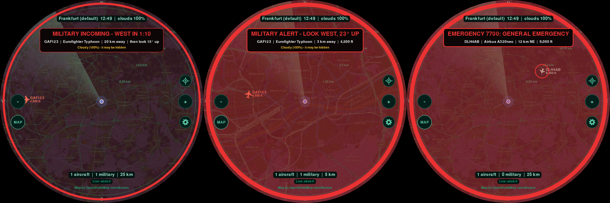
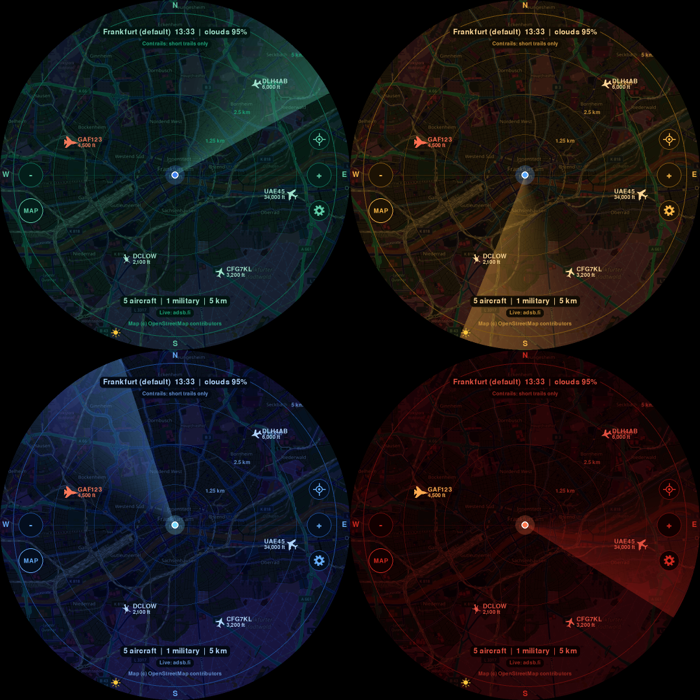

# Sky Radar

A live aircraft radar for a round touch screen and a Raspberry Pi. It shows every plane around you, with
military aircraft highlighted, on a dark street map. Tap a plane to see its details.

Built for the Waveshare 5" round 1080x1080 HDMI touch display, but it runs on any screen, including Windows and macOS for development.


## Features

- Live aircraft from the free [adsb.fi](https://adsb.fi) open data API, with [adsb.lol](https://adsb.lol) as an
  automatic backup, or from your own RTL-SDR receiver. If one service is busy or rate-limited, Sky Radar
  switches to the other by itself. The list is `api_urls` in `config.json`
- Military aircraft in coral, civil aircraft in teal, with trails and heading
- **Aircraft shapes by type:** delta-wing fighters, helicopters with a turning rotor, four-engine heavies
  (A400M, C-17, AWACS, 747 …), small light aircraft and airliners, so you recognise what's coming at a glance

  
- **"Can I see it?" and "Will I hear it?":** every alert and details card rates how easy the plane is to spot from
  the ground, from its distance, height, size, the cloud cover and the time of day (Easy to see · Visible ·
  Hard to see · Lights only at night · Not visible), plus a rough loudness estimate (e.g. "very loud", "faint", "silent")
- **Heading lines:** a short line from each plane shows where it will be in a minute, so you can see at a glance
  which ones are coming your way (when zoomed in, it's shortened to just show the direction)
- **Formations:** military jets flying together (close, same height, speed and heading for 20 s) are linked on the
  map and named in the alert and card, e.g. "Formation of 4 Eurofighter Typhoons"
- **Orbits:** military planes flying circles or racetracks, typically tankers and AWACS, are labelled "orbiting", and
  the card says where, e.g. "Orbiting 40 km NW, 2 laps in 20 min". Often a sign that fighters are training nearby
- **Rare visitors:** if a military type has never been in your sightings log before, the alert and card say
  **"RARE: first time seen here"**
- Tap a plane for a small details card. It appears on the half of the screen away from the plane, so the plane stays visible:
  - **Civil:** model (e.g. Airbus A320neo), airline, from → to, altitude, speed in knots, and arrival time at the destination
  - **Military:** model (e.g. Eurofighter Typhoon, F-35, Rafale), operator, altitude, speed,
    and when it will be closest to you. Military flights don't publish a destination.
  - The selected plane's path: **blue** = where it has flown (from takeoff), **white dashed** = the way to its destination
    (civil only). Tap the card to shrink it to a bar so the whole path is visible, and tap again to open it.
- Drag to move around the map, pinch or double-tap to zoom, like Google Maps. Your location is a blue dot, and the crosshair button brings you back
- 12 zoom steps from a 50 m radius to 150 km
- Dark OpenStreetMap map underneath, cached for offline use
- **Red screen alert** when a military aircraft is within 5 km of you, **yellow alert** when any other aircraft is within 5 km
  (distances set in `config.json` as `military_alert_km` and `civil_alert_km`). Tap the alert banner to see that plane
  - The banner says which way and how high to look, e.g. **MILITARY ALERT - LOOK WEST, 25° UP**
    (angle above the horizon, from the plane's altitude, its distance and your home's ground height)
  - **Early warning:** Sky Radar follows each plane's speed and heading up to 3 minutes ahead and warns you before
    it arrives, e.g. **MILITARY INCOMING - WEST IN 1:10**, with a calmer blink. Military beats everything else
    (`warning_lead_seconds` in `config.json`, 0 turns it off)
  - **Settings → Alert directions:** tap the compass directions you can actually see from (for example only W for a
    west-facing balcony). Planes in the other directions don't trigger alerts. **All** = alerts from every direction
  - **Weather check:** cloud cover from Open-Meteo is shown at the top ("clouds 85%"), and alerts add
    "Cloudy - it may be hidden" when the sky is overcast or visibility is poor
  - **Contrail forecast:** a line under the top bar says whether planes at cruising height leave long trails,
    short trails or none today (temperature and humidity at ~34,000 ft from Open-Meteo). Long trails make high jets
    much easier to spot
  - **Sun and glare:** a small sun on the edge of the radar shows where the sun is. If the plane will be within 20°
    of the sun from your home, the alert adds "Near the sun - shade your eyes"
  - **Auto-zoom:** during an alert the map pans and zooms by itself so you and the plane (and where it will enter
    your zone) are on screen, then goes back to your view. If you touch the map during the alert, it leaves your
    view alone (`auto_zoom` in `config.json`)
- **Emergency alerts:** any plane squawking **7700** (general emergency), **7600** (radio failure) or **7500** (hijack)
  gets a banner and a ring on the map, at any distance. Military jets in your alert zone still come first
- **Sightings log:** every military aircraft that comes within 10 km is logged (time, callsign, model, closest
  distance and direction). See it under **Settings → Sightings**: today, this week and the last 90 days.
  Stored only on the device in `sightings.json` (`sightings_km` in `config.json`)
  - **Best times:** a weekday × time-of-day chart of when jets passed, e.g. "Most often: Thu, 10:00-12:00"
  - **Records:** closest pass, lowest altitude, most-seen type, busiest day and totals
- **Airport board:** live arrivals and departures at your nearest airport (and the next two), worked out from the
  planes around it: airline, model, from/to and minutes. The airport list comes from OurAirports and is downloaded
  once (`airports.json`). Because it's estimated from flight paths, a plane landing at a small field nearby can
  occasionally show up as an arrival
- **Pi health:** CPU temperature, cooler fan speed and power/overheat throttling in Settings, plus a warning on the
  radar if the Pi gets too hot inside the enclosure
- **Automatic updates (Pi):** optional nightly check at 03:00. If there's a new version on GitHub, it installs it
  and restarts by itself, never during an alert
- **Replay:** scroll back through the last 30 minutes with a slider, step a minute at a time or play it back at 10×
  speed. Useful when you heard a jet but missed it. Alerts pause while replaying; **Live** goes back
- **Traffic chart:** how many planes were within 50 km, every 30 minutes over the last 24 hours, with military
  aircraft shown separately (stored on the device in `traffic.json`)
- **Height filter:** show only planes below 10,000 ft or 5,000 ft, which hides the airliners cruising high above
  and keeps the low, visible ones. Alerts follow the filter too
- **Colour themes:** green (classic), amber, blue, or red, which keeps your night vision when you're outside in the dark
- **Saved places:** keep up to 6 locations (home, a holiday spot, an airshow) and switch between them with one tap
- **Offline map:** download the map around your location for every zoom step in one go, so it works without internet
- **Crash watchdog (Pi):** `run.py` keeps an eye on the app. If it crashes or freezes, it restarts it within a few
  seconds and notes it in Settings. If it keeps crashing, it gives up instead of looping
- **Units:** km or miles, feet or metres, 24 h or 12 h clock (speeds stay in knots)
- **Large text:** labels, info lines and alert banners about 25% bigger, for reading the radar from across the room
- **Feed status:** which flight-data service is in use, when it last answered, requests today, and which ones are
  rate-limited or resting
- **Night mode:** dims the screen or switches it off at night (22:00–07:00 by default, `night_start` / `night_end`).
  A touch wakes it for a minute, and **military alerts always wake it**
- Settings on the screen itself (gear button), in one list you scroll by swiping up and down (or with the
  mouse wheel on a PC), grouped into four sections:
  - **General**
    - **Location:** type an address and pick from suggestions as you type
    - **Saved places:** save the current location, switch to a saved one, or remove it
    - **Wi-Fi:** choose a network and enter the password on the on-screen keyboard
    - **Alert directions:** compass to choose which sides (N, NE, E … NW) can trigger alerts
    - **Night mode:** tap to switch between Off, Dim at night and Screen off at night
  - **Views**
    - **Sightings:** the list of military aircraft seen near you, with Best times and Records
    - **Airport board:** arrivals and departures at your nearest airports
    - **Traffic:** the 24-hour traffic chart
    - **Replay:** the last 30 minutes
  - **Display**
    - **Pinch to zoom:** on/off switch for real multi-touch on the Pi (off = touch works like a mouse)
    - **Screen rotation:** ↺ / ↻ buttons turn the screen 90° at a time. On the Pi the whole screen and touch turn
      and it's remembered after a reboot; on a PC the app turns its own window.
    - **Units:** tap to switch between km · ft · 24 h, km · m · 24 h, mi · ft · 12 h and mi · ft · 24 h
    - **Text size:** Normal or Large
    - **Heading lines:** on/off
    - **Colour theme:** Green, Amber, Blue or Red
    - **Height filter:** All heights, below 10,000 ft or below 5,000 ft
  - **System**
    - **Pi health:** temperature, fan and throttling status
    - **Crash watchdog:** whether it's on and when it last restarted the app
    - **Auto updates:** on/off switch for the nightly update
    - **Feed status:** health of the flight-data services
    - **Offline map:** how much of the map is saved, tap to download the rest
- First start: if there's no internet it opens Wi-Fi setup, then asks for your location



*Alerts (example planes): a military jet on its way ("WEST IN 1:10", auto-zoomed so you and the jet are on screen),
the same jet in your zone ("LOOK WEST, 23° UP"), and an airliner squawking 7700. The cloud hint appears because it was
overcast. The small sun on the edge shows where the sun is.*


*The settings list (scrolled to each section), alert directions (west side selected), replay, the 24-hour traffic chart (example data)
and saved places.*



*The four colour themes. Red keeps your eyes adjusted to the dark.*

Want to hang it on an IKEA Skådis pegboard? There's a 3D-printable enclosure for the display and the Pi 5 in [`hardware/`](hardware/README.md).

## Quick start (one file, any system)

`run.py` detects the system and does everything: it creates a virtual environment (`.venv`),
installs the packages, and starts Sky Radar. Later runs skip whatever is already done.

| System | How to start |
|---|---|
| Windows | Install [Python 3](https://www.python.org/downloads/), then **double-click `run.py`** (or run `py run.py`) |
| Raspberry Pi / Linux | `python3 run.py` |
| macOS | `python3 run.py` |

On a Raspberry Pi it also starts fullscreen, installs any missing system packages with apt,
adds itself to the desktop autostart so the radar comes up at every boot, and turns off the
desktop's touch "mouse emulation". Raspberry Pi OS turns every touch into a single mouse pointer by
default, which makes pinch-to-zoom impossible. A backup of the original setting is saved as
`~/.config/labwc/rc.xml.before-sky-radar`. You can switch this on and off any time with
**Settings → Pinch to zoom**, and `run.py` keeps whatever you chose there.

Options: `--update` (download the newest version from GitHub and restart) · `--setup-only` (set up without starting) · `--windowed` (no fullscreen on a Pi) · `--no-autostart` · `--keep-touch-emulation` (leave the Pi's touch settings alone; pinch won't work).

Controls: drag to move the map · pinch to zoom (touch screen) · crosshair button or `H` = back to your location · tap/click a plane for details · tap empty space to close · `+`/`-` buttons or mouse wheel to zoom ·
`MAP` button or `M` to show/hide the map · gear button or `S` for settings · `F` fullscreen · `Esc`/`Q` quit.

To try the Wi-Fi screens on a PC, start with `SKY_RADAR_FAKE_WIFI=1`. That shows pretend networks, and the password is `password123`.

## Raspberry Pi setup

1. Flash **Raspberry Pi OS (64-bit, with desktop)** with Raspberry Pi Imager. You can skip Wi-Fi in the imager
   and set it up on the radar screen instead.
2. Connect the round screen: HDMI to the Pi's micro-HDMI port 0, and USB from the screen's "Touch" port to the Pi.
   If the screen stays blank, check the Waveshare wiki page for the 5inch 1080x1080 LCD for the `config.txt` lines.
3. Copy this folder to the Pi (USB stick or `git clone`), then run it once:
   ```
   cd sky-radar && python3 run.py
   ```
   That sets everything up, starts the radar fullscreen, and makes it start automatically at every boot.
   To stop autostart, delete the Sky Radar line in `~/.config/labwc/autostart`.

### Updating the Pi after you change the code

1. On your PC, commit and push your changes to GitHub:
   ```
   git add .
   git commit -m "Describe what you changed"
   git push
   ```
2. Update the Pi from your PC. It downloads the new version, installs anything new and restarts
   the radar on its screen, with no reboot needed:
   ```
   ssh sky-radar@sky-radar.local "python3 ~/sky-radar/run.py --update"
   ```
   Use your own username and hostname if you chose different ones in Raspberry Pi Imager.
   On the Pi itself (keyboard or terminal) it's just `python3 ~/sky-radar/run.py --update`.

If the update says `git pull failed`, a file in `~/sky-radar` on the Pi was edited by hand.
Undo those edits with `cd ~/sky-radar && git checkout -- .` and run the update again.
Your `location.json`, `prefs.json` and other personal files are never touched by updates.

### Wi-Fi

The Wi-Fi screen uses NetworkManager (`nmcli`), the default on Raspberry Pi OS Bookworm.
NetworkManager stores the password in its own protected system config and reconnects automatically after every reboot.
Sky Radar itself never writes the password to disk.

If connecting fails with "Not allowed to change Wi-Fi", run the app from the Pi's desktop session (autostart above),
or add your user to the `netdev` group: `sudo usermod -aG netdev $USER`, then reboot.

### Location

Tap the gear button, then **Location**, and type an address, town or place. Suggestions come from
[Photon](https://photon.komoot.io), which is based on OpenStreetMap data. Tap one and the radar is centred there.
The choice is saved in `location.json`, which is git-ignored, so your address never ends up in the repository.
`lat`/`lon` in `config.json` are only a fallback until a location is chosen.

Only a rounded position (about 1 km) is sent to the flight API.
For the "how high to look" angle, your home's ground height is looked up once from
[Open-Meteo](https://open-meteo.com) using a position rounded to about 100 m, then cached in `prefs.json`.
To skip that, set `home_elevation_m` in `config.json` (metres above sea level).
Cloud cover comes from Open-Meteo too, using a position rounded to about 1 km.
Your sightings log (`sightings.json`), traffic history (`traffic.json`), settings and saved places (`prefs.json`)
stay on the device and are git-ignored.

## Map

The map uses OpenStreetMap tiles, recoloured dark. Tiles are downloaded once into `map_tiles/` (git-ignored)
and work offline after that. `map_brightness` (0–1) in `config.json` sets how strong the map looks, and `"map": false` turns it off.
**Settings → Offline map** downloads every tile for the view around your location at every zoom step (around
750 tiles, a few minutes, once). Please keep usage light, following the [OSM tile policy](https://operations.osmfoundation.org/policies/tiles/).

## Own receiver (optional RTL-SDR dongle)

1. Plug in an RTL-SDR dongle and a 1090 MHz antenna. A window facing the sky is OK, a roof or attic is best.
2. Install readsb and tar1090 (wiedehopf's install scripts on GitHub):
   ```
   sudo bash -c "$(wget -O - https://github.com/wiedehopf/adsb-scripts/raw/master/readsb-install.sh)"
   sudo bash -c "$(wget -O - https://github.com/wiedehopf/tar1090/raw/master/install.sh)"
   sudo readsb-set-location <your-lat> <your-lon>
   ```
3. In `config.json`, change `"source": "api"` to `"source": "local"`.

Military flags come from the aircraft database that tar1090 installs. Military aircraft heard without a position
show up as "+N military heard, no position".

## Plane details

Details are fetched only for the plane you tap, and are cached:
- Model, owner and route come from [adsbdb.com](https://www.adsbdb.com). Routes come from a database of scheduled
  flights, so occasionally they are out of date.
- The flown path comes from the [OpenSky Network](https://opensky-network.org) tracks API (free, rate-limited).
  If OpenSky doesn't have the plane, the trail the radar has collected itself is shown instead.
- Many fighters don't broadcast their type at all. Then the card says "Type not broadcast".

## Notes

- Not every military aircraft is visible. Many fighters switch ADS-B off or send no position.
  The unfiltered adsb.fi / adsb.lol feeds and MLAT catch a good share of them.
- Receiving ADS-B is legal in most countries. Be thoughtful about publishing live military movements.

Map data © OpenStreetMap contributors. Flight data from adsb.fi and adsb.lol. Aircraft and route data from adsbdb.com. Flight tracks from the OpenSky Network.
Address search by Photon (komoot). Ground height, weather and contrail data from Open-Meteo. Airport list from OurAirports.

## Contributing

Improvements are welcome! Please **fork** the repo and open a **pull request**. Every change is reviewed
and approved by the maintainer before it's merged. See [CONTRIBUTING.md](CONTRIBUTING.md) for the steps.

## License

MIT © 2026 siddhesh1008. See [LICENSE](LICENSE).
