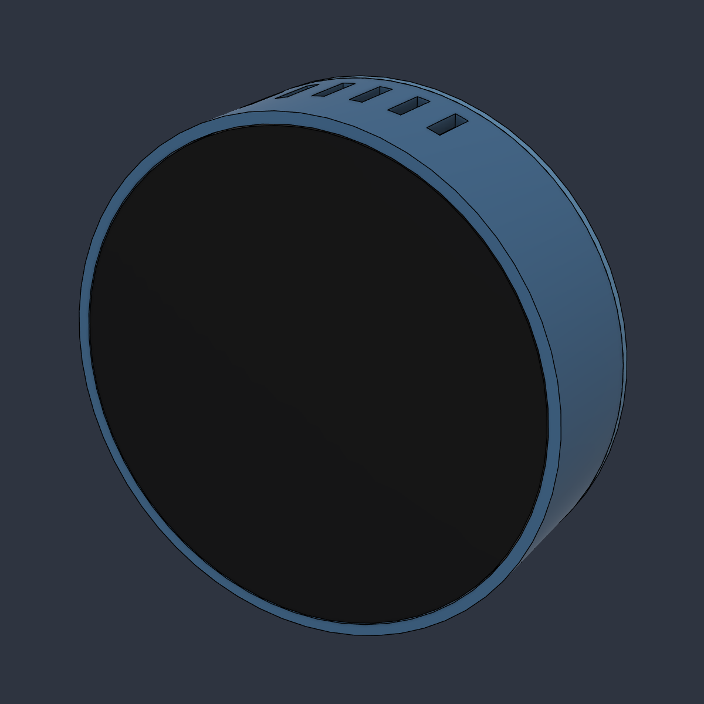
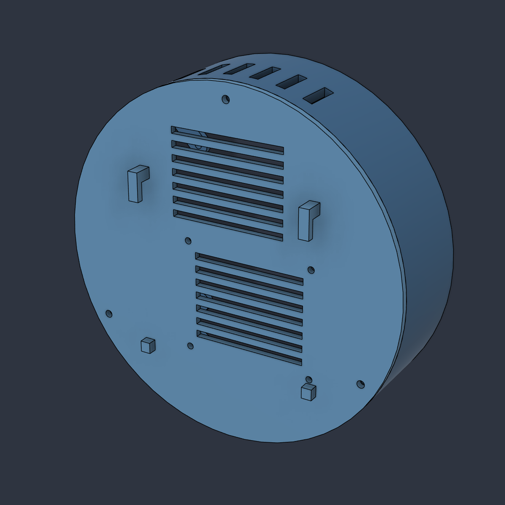
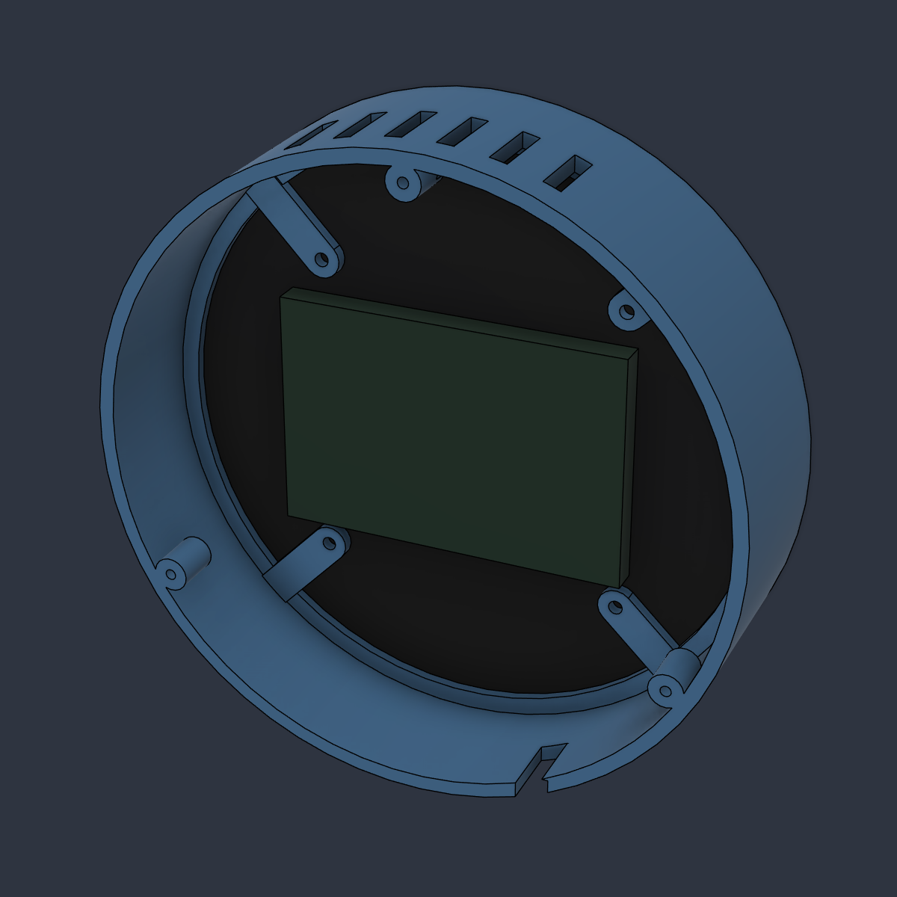
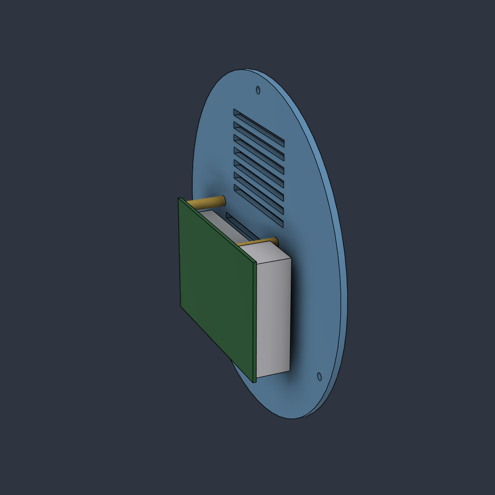
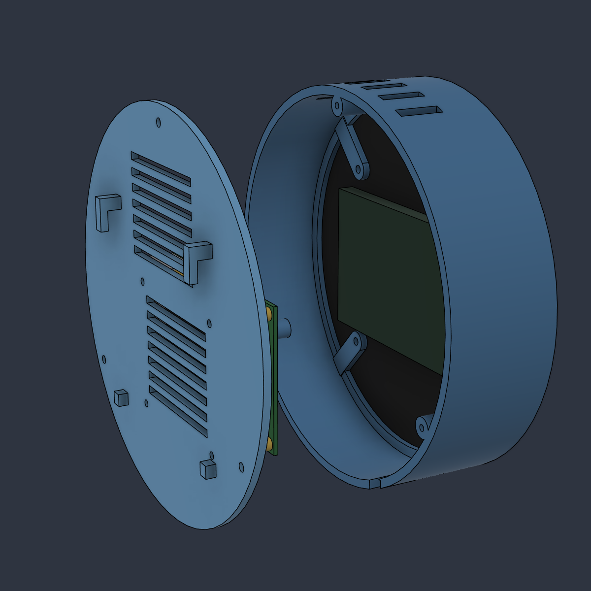
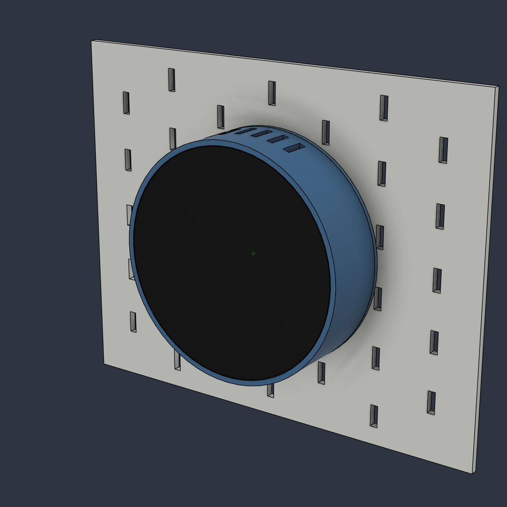
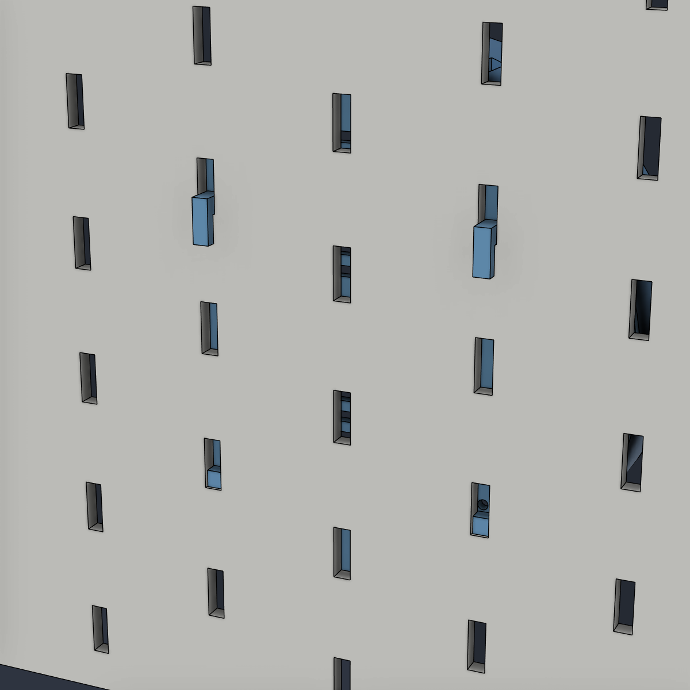

# Sky Radar: IKEA Skådis mount

A round enclosure for the Waveshare 5" round display, with a Raspberry Pi 5 and its active cooler
inside. It hangs on an IKEA Skådis pegboard. The display sits flush in the front, the Pi hangs behind it
from the back lid, and the USB-C power cable leaves through a slot in the bottom.

Outside size: Ø158 mm, 46 mm deep (57.6 mm including the Skådis hooks).

| Front | Back |
|---|---|
|  |  |
| Display flush in the front, vents in the top wall | Two Skådis hooks (top), two anti-tilt pegs (bottom), fan intake slots, lid screws |

## Files

| File | What it is |
|---|---|
| `sky-radar-mount-shell.stl` | Front shell (holds the display) |
| `sky-radar-mount-lid-skadis.stl` | Back lid with Skådis hooks, Pi mounting holes and fan vents |
| `sky-radar-mount.f3d` | Fusion 360 file to edit the design |
| `sky-radar-mount.step` | STEP for other CAD programs |
| `images/` | The pictures used in this guide |

The `.f3d` and `.step` also contain simple stand-ins named `REF …` (display, Pi 5, cooler, standoffs)
for checking the fit. They are not printed.

## Printing (settings for a Bambu Lab printer)

- **Material:** PETG is recommended, since the Pi runs warm inside. PLA works if the room stays cool.
- 0.2 mm layers, 4 walls, 15–20 % infill.
- **Shell:** print **front face down** (it is exported in this orientation).
  Supports: **tree supports, build plate only**, for the four display-screw arms and the lid screw bosses.
- **Lid:** print **inner face down, hooks pointing up** (exported this way). No supports needed.

## Hardware

| Qty | Part | Used for |
|---|---|---|
| 4 | M3 × 6 mm screws | Display → shell (into the display's 75 × 75 mm threaded bosses) |
| 3 | M3 × 10 mm screws | Lid → shell (they cut their own thread in the plastic) |
| 4 | M2.5 × 20 mm female–female standoffs | Pi 5 → lid |
| 8 | M2.5 × 5 mm screws | Both ends of the standoffs |
| 1 | Short micro-HDMI → HDMI cable (15–20 cm, flexible) | Pi → display |
| 1 | Short USB-A → USB-C cable | Pi → display touch |
| 1 | USB-C power cable (≤ 7 mm thick) | Power, out through the bottom slot |

## Assembly

### Step 1: Fit the display into the shell



1. Turn the display so its **connectors (HDMI, USB-C) point down**.
2. Push it into the front of the shell until it rests on the inner ledge. The glass ends up flush with the front.
3. From behind, screw it in with **4 × M3 × 6 mm** screws through the four arms into the display's threaded holes.
   Tighten gently. The arms only need to hold, not clamp.

You can also see the three lid screw posts on the inside wall, and the **USB-C cable slot** in the bottom edge.

### Step 2: Mount the Pi 5 on the lid



1. Screw the **4 × M2.5 × 20 mm standoffs** (brass) to the lid, with the screws going in from the outside of the lid.
2. Fit the active cooler to the Pi 5 if it isn't on already.
3. Mount the Pi **upside down** on the standoffs, with the **cooler facing the lid** (silver block in the
   picture). The fan sits right under the lower vent slots and pulls fresh air straight in.

### Step 3: Connect the cables and close the lid



1. Connect the **micro-HDMI → HDMI** cable from the Pi to the display, and the **USB-A → USB-C** touch cable.
   Tuck the loops into the bottom of the shell.
2. Plug the **USB-C power cable** into the Pi and lay the cable into the **slot in the bottom of the shell**.
   The slot is open towards the back, so the plug doesn't need to fit through it.
3. Put the lid on, hooks facing out, and fasten it with **3 × M3 × 10 mm** screws.

### Step 4: Hang it on the Skådis board



1. Hold the radar about 1 cm higher than where it should end up and push the **two top hooks** straight
   into two slots in the same row, **80 mm apart** (one empty slot column between them).
2. Let it drop down. The hooks catch behind the board, and the **two bottom pegs** slide into the slots
   below so it can't tip or swing.



*Seen from behind the board: the two hooks come through their slots and hang down behind the board,
and the pegs sit in the slots further down.*

## Screen orientation

The shell holds the display with its connectors (HDMI, USB-C) pointing **down**, so the cables run to
the bottom where the power slot is. The display's screw pattern only fits this one way round.

The Waveshare display's picture is upright when its connectors point **up**, so the picture has to be
**rotated 180°** on the Pi. Touch rotates along with it:

- In Sky Radar: **Settings → Screen rotation**, tap ↻ twice (2 × 90° = 180°).
- With the desktop: **Preferences → Screen Configuration**, right-click the screen →
  **Orientation → Inverted** → Apply.
- Or put this in `~/.config/kanshi/config` and reboot:
  ```
  profile {
  	output HDMI-A-1 enable mode 1080x1080@60.069 position 0,0 transform 180
  }
  ```

## Before printing, check

- The display's mounting bosses are assumed to be **M3**. Try an M3 screw in one before printing.

Display dimensions are taken from Waveshare's official 3D model (5inch 1080x1080 LCD, SKU 24369).
The pictures are rendered from the Fusion 360 model in this folder.
